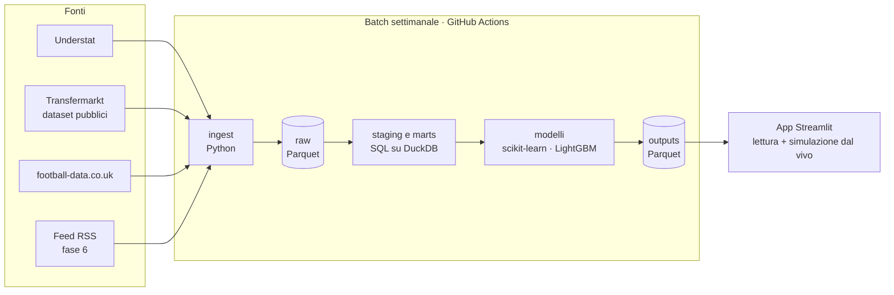

# Architettura

## Principio

L'app **non addestra niente**: legge tabelle già pronte. Tutto il lavoro pesante (scaricare, pulire,
addestrare) gira in batch, una volta a settimana. Così l'app resta piccola e gratuita, e ogni numero
mostrato è riproducibile da uno script.

L'unico calcolo fatto dal vivo è la **simulazione del campionato**: 10.000 stagioni richiedono circa
un secondo, quindi il simulatore interattivo può ricalcolare a ogni modifica dell'utente.



## Linguaggi e librerie

| Livello | Scelta | Perché |
|---|---|---|
| Linguaggio | **Python 3.11+** | Un solo linguaggio per dati, modelli e prima app |
| Trasformazioni | **SQL su DuckDB**, file Parquet | Nessun server, veloce su un portatile, legge direttamente CSV e Parquet |
| Modelli | numpy/scipy (Poisson), **scikit-learn**, **LightGBM** | Sufficienti per dati tabellari di queste dimensioni (decine di migliaia di righe) |
| Simulazione | numpy vettorizzato | 10.000 stagioni in circa un secondo |
| App | **Streamlit** | Dal modello alla pagina web senza scrivere frontend |
| Qualità | `uv`, `ruff`, `pytest`, GitHub Actions | Già configurati nella repo |

Scelte volutamente rimandate: orchestratori (Airflow, Dagster), dbt, MLflow, database server, Docker.
Per un progetto di queste dimensioni aggiungono manutenzione senza risolvere un problema reale;
`make` e GitHub Actions bastano.

## Servizi, tutti gratuiti

| Servizio | Uso | Limiti da conoscere |
|---|---|---|
| **GitHub** (repo pubblica) | Codice, issue, CI | I dati grezzi non vanno nella repo |
| **GitHub Actions** | Test a ogni push; aggiornamento settimanale programmato | Gratis sulle repo pubbliche con runner standard. I job programmati si disattivano dopo 60 giorni senza attività sulla repo |
| **Streamlit Community Cloud** | Hosting dell'app | App pubbliche illimitate, una sola privata; l'app va in pausa dopo un periodo senza visite e riparte al primo accesso; memoria limitata (le fonti indicano tra 1 e 2,7 GB) |
| Archivio dei dati tra un'esecuzione e l'altra | Storico grezzo e tabelle intermedie | Da scegliere in fase 5: dataset privato su Hugging Face oppure Cloudflare R2 (piani gratuiti da verificare al momento) |

Le sole tabelle pubblicate sono gli **output** (previsioni e classifiche simulate): piccole, derivate,
senza dati grezzi delle fonti.

## Struttura della repo

```
src/xmercato/
├── ingest/       # un modulo per fonte            (football_data, transfermarkt: fatti)
├── features/     # tabelle giocatore-stagione e club-stagione
├── models/       # poisson (fatto), proiezioni, valore, successo acquisti
├── recommend/    # fabbisogno, plausibilità, lista per club
├── sim/          # season (fatto), con scenari "e se"
├── samples/      # una stagione completa per test ed esempi
└── cli.py        # xmercato simulate ...          (fatto)
app/              # Streamlit: simulatore di livello 1 (fatto)
rose/             # rose compilate a mano, un CSV per stagione (formato e controllo: xmercato.rose)
tests/            # ogni modello ha un test su dati sintetici a parametri noti
docs/             # questi documenti
```

## Evoluzione

**Simulatore tra amici.** Servono utenti, stato condiviso (rose, budget, turni) e scritture
concorrenti: Streamlit non è lo strumento adatto. Il passaggio previsto:

- il motore (`models/`, `sim/`) resta com'è e viene esposto da una piccola **API FastAPI**;
- **Supabase** (piano gratuito) per login e database Postgres;
- frontend web vero (per esempio SvelteKit o Next.js) su Cloudflare Pages o Vercel.

Per questo il codice dei modelli non deve mai dipendere da Streamlit.

**Dove avrebbe senso pagare**, in ordine di utilità:

1. dati per i campionati fuori dai Big 5 (API-Football, da 19 USD al mese);
2. una API LLM per leggere le notizie, se i piani gratuiti non bastano;
3. hosting sempre attivo, solo se l'app viene usata davvero.

I dati di livello professionale (Opta, StatsBomb, Wyscout) hanno prezzi da azienda e restano fuori portata.
