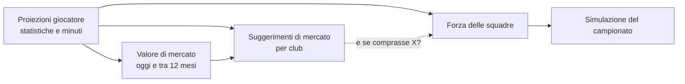

# Studio del progetto

## L'idea

xMercato risponde a tre domande sulla Serie A:

1. **Quanto varrà e come renderà un giocatore l'anno prossimo?**
2. **Quali acquisti verosimili dovrebbe fare ciascuna delle 20 squadre, e con che probabilità sarebbero buoni acquisti?**
3. **Come finirà il campionato?**

I tre pezzi sono collegati, ed è il collegamento a rendere il progetto interessante:

Il prodotto finale è il ciclo "e se": scelgo un acquisto per una squadra e vedo come cambiano i suoi
punti attesi. È anche la base naturale del simulatore da usare tra amici.

## I quattro modelli

### A. Proiezioni del giocatore

- **Cosa prevede:** per la stagione successiva, i minuti giocati e i tassi per 90 minuti
  (npxG, xA, tiri, passaggi chiave, gol, assist).
- **Punto di partenza:** metodo "Marcel": media pesata delle ultime tre stagioni, regressione verso la
  media del ruolo (più forte per chi ha giocato poco), correzione per l'età. È semplice e difficile da battere.
- **Passo successivo:** gradient boosting o modello gerarchico; **coefficienti di campionato** stimati
  sui giocatori che hanno cambiato lega (quanto "vale" un gol in Eredivisie rispetto alla Serie A);
  effetto della squadra di arrivo.
- **Come si valuta:** addestramento sulle stagioni fino a T, verifica su T+1. Errore medio contro due
  riferimenti: "uguale all'anno scorso" e Marcel.
- **Dubbi:** i minuti sono la parte più difficile (infortuni, allenatore, concorrenza) e pesano più dei tassi.

### B. Valore di mercato

- **Cosa prevede:** il valore Transfermarkt, in due versioni: "valore equo oggi" (lo scarto dal valore
  reale indica chi è sopra o sottovalutato) e "valore tra 12 mesi".
- **Variabili:** età (non lineare), ruolo, minuti, rendimento per 90, forza del campionato e del club,
  presenze in nazionale, scadenza del contratto, traiettoria del valore.
- **Come si valuta:** errore sul logaritmo del valore, per fasce. Il riferimento da battere è
  "il valore resta quello di oggi, corretto per la curva d'età": è un riferimento forte.
- **Dubbi:** il valore Transfermarkt è una stima della comunità, non un prezzo. I prezzi veri
  (trasferimenti pagati) sono pochi e distorti: si vede solo chi è stato venduto.
  Attenzione alle fughe di informazione: il valore di oggi contiene già notizie che le statistiche non vedono.

### C. Suggerimenti di mercato

Tre passaggi separati, ognuno verificabile da solo.

1. **Fabbisogno.** Per ogni club e ruolo: minuti coperti dalla rosa l'anno prossimo (proiezioni A,
   età, contratti e prestiti in scadenza) confrontati con il livello medio del campionato in quel ruolo.
2. **Plausibilità.** Probabilità che *quel* club compri *quel* giocatore, imparata dai trasferimenti
   passati: costo stimato rispetto alle spese abituali del club, età rispetto al profilo dei suoi
   acquisti, campionato di provenienza, differenza di livello tra i due club, contratto residuo.
   Vincoli espliciti dove servono (per esempio i posti per extracomunitari).
3. **Probabilità di buon acquisto.** Classificatore calibrato, addestrato sui trasferimenti verso i
   Big 5 con almeno due stagioni di storia successiva.

Per ogni club l'uscita è una lista per ruolo: costo stimato, plausibilità, probabilità di successo,
variazione dei punti attesi (dal modello D).

- **Come si valuta:** per la plausibilità, quanti acquisti reali di un'estate passata comparivano tra
  i primi N suggeriti. Per il successo, curva di calibrazione e Brier score contro la frequenza di base.
- **Dubbi:** la definizione di "buon acquisto" è una scelta, non un fatto (vedi [decisioni prese](#decisioni-prese)).
  Prestiti con diritto o obbligo di riscatto, molto usati in Serie A, complicano il costo.
  Volontà del giocatore, procuratori e stipendi non si osservano.

### D. Classifica

- **Punto di partenza (già nel codice):** forza in attacco e in difesa di ogni squadra stimata dai
  risultati con un modello di Poisson, poi 10.000 simulazioni delle partite rimanenti.
- **Passi successivi:** xG al posto dei gol, peso maggiore alle partite recenti, correzione
  Dixon-Coles per i punteggi bassi, e soprattutto una **stima pre-stagionale** dalla rosa
  (valore di mercato e proiezioni A), indispensabile per le neopromosse e per collegare il mercato alla classifica.
- **Come si valuta:** per partita, log-loss e RPS contro le quote di chiusura dei bookmaker;
  per la classifica, errore sui punti finali su dieci stagioni.
- **Dubbi:** battere i bookmaker non è un obiettivo realistico; avvicinarsi sì.
  380 partite a stagione sono poche: molta differenza tra modelli è rumore.

## Pro

- **Si parte da modelli semplici e spiegabili**, ognuno con un riferimento da battere: i miglioramenti si misurano.
- **Ogni modulo si può mostrare da solo.** La classifica funziona già; non serve finire tutto per avere qualcosa da far vedere.
- **Costo zero** nella versione iniziale (vedi [ARCHITETTURA.md](ARCHITETTURA.md)).
- **Buon progetto da portfolio:** raccolta dati, collegamento di fonti diverse, modelli, simulazione, app.
  Le probabilità calibrate con verifica sul passato valgono più di un modello complicato.

## Limiti

- **Dettaglio dei dati.** Gratis e aggiornabile si arriva a tiri e xG. Niente dati di tracking, niente
  eventi completi. Vedi [DATI.md](DATI.md).
- **Dati freschi.** Il dataset Transfermarkt principale è fermo a luglio 2026.
- **Fuori dai Big 5 si vede poco**, ed è da lì che arrivano molti acquisti della Serie A.
- **Il calcio è rumoroso.** Le previsioni vanno presentate come intervalli e probabilità, mai come numeri secchi.
- **Manutenzione.** Gli scraper si rompono. Con poche fonti e una cache locale il danno è limitato, ma non nullo.
- **Aspetti legali.** Termini d'uso delle fonti: progetto personale, nessun dato grezzo ridistribuito.

## Integrazioni possibili

| Integrazione | Cosa aggiunge | Costo | Note |
|---|---|---|---|
| **Notizie e voci di mercato** | Contesto nell'app ("se ne parla"), e un segnale di "intensità delle voci" per la plausibilità | Gratis con feed RSS e GDELT; l'estrazione con un LLM può richiedere una API a pagamento | Si salvano solo titolo, link, data ed entità riconosciute, mai il testo. Sotto-progetto carino: **affidabilità delle fonti**, cioè quante voci di ciascuna testata si sono avverate |
| Infortuni | Migliora il modello dei minuti | Gratis (storico in `salimt/football-datasets`) | Storico fermo a ottobre 2025 |
| Quote dei bookmaker | Riferimento per la classifica, eventuale media con il modello | Gratis (football-data.co.uk) | Già previste per la valutazione |
| Attributi EA FC | Informazione di partenza per chi non ha xG | Gratis (Kaggle) | Valutazioni soggettive |
| Fantacalcio | Le proiezioni A diventano un aiuto per l'asta | Gratis | Buon gancio per gli amici |
| Statistiche extra Big 5 | Colma il buco principale | API-Football a pagamento (da 19 USD/mese) | Primo candidato se si decide di spendere |
| **Simulatore tra amici** | Ognuno gestisce un club con un budget, mercato a turni, stagione simulata | Gratis entro i piani free (serve login e database) | Cambia l'architettura: vedi [ARCHITETTURA.md](ARCHITETTURA.md#evoluzione) |

## Decisioni prese

Registro delle scelte, con la data. Si cambia idea aggiungendo una riga, non cancellando.

| Data | Tema | Decisione |
|---|---|---|
| 16/11/2026 | **"Buon acquisto"** | Entro due stagioni dall'arrivo il giocatore ha giocato almeno il 40% dei minuti disponibili **e** il suo valore è almeno quello atteso per la sua età |
| 16/11/2026 | **Rose 2026/27** | Raccolte a mano per le 20 squadre di Serie A, finché il dataset Transfermarkt resta fermo. Formato in [DATI.md](DATI.md#rose-raccolte-a-mano) |
| 16/11/2026 | **Candidati** | Tutti i campionati. Fuori dai Big 5 i dati sono ridotti: l'incertezza viene stimata e mostrata accanto a ogni suggerimento |
| 16/11/2026 | **Finestre di mercato** | Entrambe: gennaio 2027 con una versione ridotta, estate 2027 con quella completa (vedi [ROADMAP.md](ROADMAP.md#due-traguardi)) |
| 16/11/2026 | **Lingua** | Documentazione e README in italiano |
| 16/11/2026 | **Prestiti** | Di norma un prestito non è un acquisto: prestito secco e diritto di riscatto non esercitato restano fuori. Obbligo di riscatto e diritto esercitato contano come acquisto dalla data di arrivo. Scelta provvisoria, da rivedere sui dati |
| 16/11/2026 | **Soglia dei minuti** | Non è fissa: dipende dal ruolo per cui il giocatore è stato preso. Un secondo portiere che fa il secondo portiere è un acquisto riuscito |
| 16/11/2026 | **Acquisti di gennaio** | Stessa definizione, valutata sulla stagione e mezza disponibile |
| 16/11/2026 | **Simulatore interattivo** | Previsto, in tre livelli crescenti (vedi [ROADMAP.md](ROADMAP.md#simulatore-interattivo)) |

### Come si applica la definizione di "buon acquisto"

- **Ruolo atteso.** Al momento dell'acquisto si stima per cosa è stato preso il giocatore: titolare,
  rotazione o riserva. La stima usa solo ciò che si sapeva allora: costo rispetto alle spese del club,
  valore rispetto ai compagni di reparto, età. Da qui vengono i **minuti attesi**.
- **Criterio dei minuti.** L'acquisto supera il criterio se ha giocato almeno quanto atteso per il suo
  ruolo. Il 40% dei minuti disponibili resta la soglia per chi è stato preso da titolare; per rotazione
  e riserva la soglia scende in proporzione ai minuti attesi. I valori esatti si calibrano nella fase 4.
- **Criterio del valore.** Invariato: valore almeno pari a quello atteso per l'età, dal modello B.
  Serve quindi la fase 3 prima della fase 4.
- **Minuti disponibili.** I minuti di campionato del club che lo ha comprato; i periodi passati in
  prestito altrove contano come minuti non giocati.
- **Finestra di osservazione.** Due stagioni per gli acquisti estivi, una stagione e mezza per quelli
  di gennaio, con minuti disponibili e valore atteso calcolati sullo stesso periodo.
- **Dati utilizzabili.** L'etichetta richiede la finestra completa: l'ultima estate utilizzabile per
  l'addestramento è il 2024, l'ultimo gennaio il 2025.

Rischio da tenere d'occhio: il ruolo atteso è a sua volta una stima. Se è sbagliata, un titolare mancato
passa per una riserva riuscita. Va verificata a mano su un campione di acquisti noti.

## Domande aperte

1. **Quanto tempo a settimana?** La roadmap ipotizza 5-6 ore.
2. **Ruolo atteso:** tre classi (titolare, rotazione, riserva) bastano, o serve una stima continua dei minuti attesi?
3. **Prestiti:** la regola provvisoria esclude molti affari tipici della Serie A. Da ricontrollare quando ci sono i numeri.
