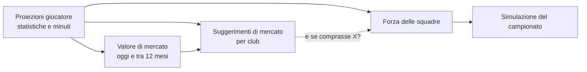

# Studio del progetto

## L'idea

xMercato risponde a tre domande sulla Serie A:

1. **Quanto varrà e come renderà un giocatore l'anno prossimo?**
2. **Quali acquisti verosimili dovrebbe fare ciascuna delle 20 squadre, e con che probabilità sarebbero buoni acquisti?**
3. **Come finirà il campionato?**

I tre pezzi sono collegati, ed è il collegamento a rendere il progetto interessante:

Il prodotto finale è il ciclo "e se": scelgo un acquisto per una squadra e vedo come cambiano i suoi
punti attesi. È anche la base naturale del simulatore da usare tra amici.

## I quattro modelli

### A. Proiezioni del giocatore

- **Cosa prevede:** per la stagione successiva, i minuti giocati e i tassi per 90 minuti
  (npxG, xA, tiri, passaggi chiave, gol, assist).
- **Punto di partenza:** metodo "Marcel": media pesata delle ultime tre stagioni, regressione verso la
  media del ruolo (più forte per chi ha giocato poco), correzione per l'età. È semplice e difficile da battere.
- **Passo successivo:** gradient boosting o modello gerarchico; **coefficienti di campionato** stimati
  sui giocatori che hanno cambiato lega (quanto "vale" un gol in Eredivisie rispetto alla Serie A);
  effetto della squadra di arrivo.
- **Come si valuta:** addestramento sulle stagioni fino a T, verifica su T+1. Errore medio contro due
  riferimenti: "uguale all'anno scorso" e Marcel.
- **Dubbi:** i minuti sono la parte più difficile (infortuni, allenatore, concorrenza) e pesano più dei tassi.

### B. Valore di mercato

- **Cosa prevede:** il valore Transfermarkt, in due versioni: "valore equo oggi" (lo scarto dal valore
  reale indica chi è sopra o sottovalutato) e "valore tra 12 mesi".
- **Variabili:** età (non lineare), ruolo, minuti, rendimento per 90, forza del campionato e del club,
  presenze in nazionale, scadenza del contratto, traiettoria del valore.
- **Come si valuta:** errore sul logaritmo del valore, per fasce. Il riferimento da battere è
  "il valore resta quello di oggi, corretto per la curva d'età": è un riferimento forte.
- **Dubbi:** il valore Transfermarkt è una stima della comunità, non un prezzo. I prezzi veri
  (trasferimenti pagati) sono pochi e distorti: si vede solo chi è stato venduto.
  Attenzione alle fughe di informazione: il valore di oggi contiene già notizie che le statistiche non vedono.

### C. Suggerimenti di mercato

Tre passaggi separati, ognuno verificabile da solo.

1. **Fabbisogno.** Per ogni club e ruolo: minuti coperti dalla rosa l'anno prossimo (proiezioni A,
   età, contratti e prestiti in scadenza) confrontati con il livello medio del campionato in quel ruolo.
2. **Plausibilità.** Probabilità che *quel* club compri *quel* giocatore, imparata dai trasferimenti
   passati: costo stimato rispetto alle spese abituali del club, età rispetto al profilo dei suoi
   acquisti, campionato di provenienza, differenza di livello tra i due club, contratto residuo.
   Vincoli espliciti dove servono (per esempio i posti per extracomunitari).
3. **Probabilità di buon acquisto.** Classificatore calibrato, addestrato sui trasferimenti verso i
   Big 5 con almeno due stagioni di storia successiva.

Per ogni club l'uscita è una lista per ruolo: costo stimato, plausibilità, probabilità di successo,
variazione dei punti attesi (dal modello D).

- **Come si valuta:** per la plausibilità, quanti acquisti reali di un'estate passata comparivano tra
  i primi N suggeriti. Per il successo, curva di calibrazione e Brier score contro la frequenza di base.
- **Dubbi:** la definizione di "buon acquisto" è una scelta, non un fatto (vedi [decisioni prese](#decisioni-prese)).
  Prestiti con diritto o obbligo di riscatto, molto usati in Serie A, complicano il costo.
  Volontà del giocatore, procuratori e stipendi non si osservano.

#### Versione di gennaio 2027 (fase G)

Prima versione, costruita con quello che c'è oggi: rose verificate a mano, minuti e formazioni dal
dataset Transfermarkt (14 campionati europei, fino al 2025/26), valori di luglio 2026. Codice in
`src/xmercato/recommend/`, risultati in `mercato/`, pagina **Mercato** nell'app.

- **Fabbisogni** (`needs.py`). Otto ruoli (portiere, centrale, terzino o esterno destro e sinistro,
  centrocampista centrale, trequartista o seconda punta, esterno d'attacco, centravanti). Per ognuno:
  quanti giocatori ci sono contro quanti ne servono col modulo usato l'anno scorso (un ricambio per
  titolare, tre portieri; i giocatori in più di un ruolo vicino contano mezzo); quanto valgono i
  titolari rispetto a un titolare tipico della squadra, al netto del distacco che c'è di solito in quel
  ruolo; età e contratti in scadenza.
- **Candidati** (`candidates.py`). Tutti i giocatori visti nel 2025/26 nei 14 campionati. Un modello
  logistico, addestrato sugli acquisti dei club di Serie A dal 2019 contro un campione dei non
  acquistati, stima la probabilità che *quel* club prenda *quel* giocatore nella finestra. Conta
  soprattutto il prezzo rispetto al livello del club (né troppo caro né troppo poco), poi età,
  esperienza in Serie A, minuti giocati, nazionalità e rapporti precedenti tra i due club.
- **Ruolo previsto.** Titolare se il candidato vale almeno quanto i titolari attuali del ruolo,
  rotazione se almeno la metà, altrimenti riserva: è il ruolo con cui verrà giudicato il "buon acquisto".

**Verifica** (`uv run xmercato mercato verifica`): addestramento sulle finestre 2019–2022, prova sulle
2023–2025, ricostruendo ogni volta la rosa e il mercato con quello che si sapeva prima della finestra.

| Candidati: dove cadeva l'acquisto vero tra i circa 1.200 candidati del suo ruolo | Primi 10 | Primi 50 | Rango mediano |
|---|---|---|---|
| Modello | **18%** | **43%** | **73** |
| Giocatori col valore più vicino a quello della squadra | 5% | 24% | 125 |
| A caso | 0,2% | 4% | 570 |

Le probabilità sono calibrate: sulle finestre di prova il modello si aspettava 407 acquisti dai
campionati coperti, ce ne sono stati 468. Due acquisti su tre arrivano da questi campionati; il terzo
da Serie B, Sudamerica e campionati senza statistiche nel dataset, che la lista non vede.

| Fabbisogni: acquisti veri caduti nei due ruoli più "urgenti" | Gennaio | Estate |
|---|---|---|
| Classifica dei fabbisogni | 23% | 24% |
| Ruoli comprati più spesso (centrocampo e difesa centrale) | 38% | 37% |
| A caso | 25% | 25% |

**I fabbisogni non prevedono dove compra un club.** Nemmeno la profondità da sola: i reparti corti
non vengono rinforzati più spesso degli altri. Le cause probabili: partenze e infortuni che una rosa
ricostruita dalle presenze non mostra, acquisti di occasione, giovani presi per essere girati in
prestito. Per questo nell'app la classifica dei fabbisogni è presentata come una lettura della rosa,
non come una previsione; resta utile per scegliere in quale ruolo guardare i candidati.

**Rendimento della stagione** (`performance.py`, aggiunto il 18/11/2026). Due segnali, entrambi
misurati contro le attese di inizio stagione:

- *Reparti*, per tutte le squadre e solo dai risultati: gol fatti e subiti finora contro quelli che il
  modello della classifica (fase 1) si aspettava dalle forze di inizio stagione e dagli avversari
  incontrati, al netto di quanto si segna in tutto il campionato quest'anno. Un attacco sotto le
  attese alza l'urgenza di centravanti (pieno), esterni e trequartisti (70%); una difesa sotto le
  attese quella di centrali (pieno), portiere (70%) e terzini (50%).
- *Attaccanti titolari*, con i marcatori di football-data.org (gol, assist, partite): gol più assist
  per partita contro quelli dei giocatori di pari ruolo e valore in Serie A dal 2018 (regressione di
  Poisson). Un titolare che non compare tra i marcatori conta come zero, su metà delle partite.

Ogni segnale è uno scarto in deviazioni standard (approssimazione di Poisson): da zero a tre sotto le
attese diventa un'urgenza da 0 a 1. **È l'unico segnale che i club seguono davvero.** A gennaio,
dal 2019 al 2025, ha comprato un centravanti:

| Attacco a fine dicembre, rispetto alle attese | Squadre | Hanno preso un centravanti |
|---|---|---|
| Molto sotto (oltre una deviazione standard) | 32 | **50%** |
| Poco sotto | 33 | 36% |
| Poco sopra | 46 | 28% |
| Molto sopra | 29 | 24% |

Per la difesa è lo stesso: ha preso un centrale il 63% delle squadre con la difesa molto sotto le
attese, contro il 32–39% delle altre. Aggiunto alla classifica dei fabbisogni di gennaio, sulle finestre
2023–2025 porta gli acquisti caduti nei due ruoli più urgenti dal 23% al 27% (nel primo ruolo dal 9% al
15%). I pesi di gennaio sono stati scelti sul 2019–2022: profondità 1, rendimento 1,2, qualità 0,25
(la qualità peggiorava la previsione, resta come lettura della rosa).

**Infortuni** (`availability.py`). Da una lista tenuta a mano (vedi [DATI.md](DATI.md#infortunati)):
chi resta fuori oltre la chiusura della finestra esce dal calcolo della rosa, chi è infortunato non viene
giudicato sui gol; i candidati fuori oltre la finestra spariscono dalla lista. L'app ricalcola i fabbisogni
dai pezzi salvati in `mercato/` (rosa, utilizzo dei ruoli, rendimento), così una modifica all'elenco
degli infortuni si vede subito. Non c'è uno storico degli infortuni, quindi questo pezzo non è
verificato sul passato. Il simulatore della classifica invece non tiene conto degli infortuni: stima
la forza delle squadre solo dai risultati.

**Cosa manca ancora:** la probabilità di *buon* acquisto (servono le proiezioni dei giocatori, fasi 2-4)
e i campionati senza statistiche.

### D. Classifica

- **Modello attuale.** Forza in attacco e in difesa di ogni squadra con un modello di Poisson, poi
  migliaia di simulazioni delle partite rimanenti. La forza si stima dalla stagione in corso **e dalle
  due precedenti**, con le partite più vecchie che pesano meno (metà peso ogni 270 giorni) e le
  neopromosse che partono sotto la media (`src/xmercato/models/forecast.py`).
- **Passi successivi:** correzione Dixon-Coles per i punteggi bassi e soprattutto una **stima
  pre-stagionale dalla rosa** (valore di mercato e proiezioni A): è il pezzo che collega il mercato alla
  classifica, e il punto in cui il modello perde di più contro i bookmaker (inizio stagione, squadre
  che cambiano molto in estate).
- **Dubbi:** battere i bookmaker non è un obiettivo realistico; avvicinarsi sì.
  380 partite a stagione sono poche: molta differenza tra modelli è rumore.

#### Verifica sul passato (backtest)

Ogni settimana di una stagione il modello viene stimato **solo sulle partite già giocate** e prevede
quelle della settimana. Le probabilità 1X2 si confrontano con i risultati e con le quote di chiusura dei
bookmaker (Pinnacle quando c'è, altrimenti la media del mercato, margine tolto). Le impostazioni sono
state scelte sulle stagioni **2015–2019** (circa 300 combinazioni) e poi misurate, senza più toccarle,
sulle **2020–2025**: 2.280 partite. Si rifà con `uv run xmercato backtest`.

| Modello (prove 2020–2025) | Log loss | RPS | Brier |
|---|---|---|---|
| Quote dei bookmaker | **0,962** | **0,189** | **0,573** |
| Due stagioni precedenti, gol + xG a metà | 0,984 | 0,195 | 0,586 |
| Due stagioni precedenti, solo gol (**usato nell'app**) | 0,985 | 0,196 | 0,587 |
| Solo la stagione in corso, gol (modello di partenza) | 1,015 | 0,205 | 0,607 |
| Riferimento: 1/3 a ogni esito | 1,099 | | |

Più basso è meglio. Cosa se ne ricava:

- **Le stagioni precedenti contano davvero.** Il modello nuovo recupera circa il **57%** della
  distanza tra il modello di partenza e i bookmaker (differenza di 0,030 ± 0,011 per partita, ben oltre
  il rumore). Quasi tutto il guadagno è nelle prime dieci giornate (log loss 1,064 → 0,981), quando la
  sola stagione in corso dice pochissimo.
- **Gli xG aiutano poco.** Mescolare a metà gol e xG migliora di 0,002 ± 0,0025: dentro il rumore.
  Usare solo gli xG va peggio che usare solo i gol. Per questo l'app usa il modello con i soli gol, che
  non ha bisogno di una fonte di xG per la stagione in corso (vedi [DATI.md](DATI.md#storico-per-la-classifica)).
- **I bookmaker restano avanti** di 0,021 ± 0,007 per partita, soprattutto a inizio stagione: sanno del
  mercato estivo, degli infortuni e degli allenatori nuovi, il modello no.

Errore medio sui punti finali (per squadra), simulando il resto della stagione da una certa giornata:

| Simulando da… | Inizio | Giornata 10 | Giornata 19 | Giornata 28 |
|---|---|---|---|---|
| Due stagioni precedenti, solo gol | 8,9 | **6,4** | 4,7 | 3,1 |
| Solo la stagione in corso | — | 7,8 | **4,6** | **3,0** |
| Media punti attuale proiettata | — | 9,1 | 5,6 | 3,3 |

Prima del via il modello sbaglia di quasi 9 punti a squadra: senza il mercato estivo non può fare di
meglio. Dalla metà stagione in poi i due modelli si equivalgono.

## Pro

- **Si parte da modelli semplici e spiegabili**, ognuno con un riferimento da battere: i miglioramenti si misurano.
- **Ogni modulo si può mostrare da solo.** La classifica funziona già; non serve finire tutto per avere qualcosa da far vedere.
- **Costo zero** nella versione iniziale (vedi [ARCHITETTURA.md](ARCHITETTURA.md)).
- **Buon progetto da portfolio:** raccolta dati, collegamento di fonti diverse, modelli, simulazione, app.
  Le probabilità calibrate con verifica sul passato valgono più di un modello complicato.

## Limiti

- **Dettaglio dei dati.** Gratis e aggiornabile si arriva a tiri e xG. Niente dati di tracking, niente
  eventi completi. Vedi [DATI.md](DATI.md).
- **Dati freschi.** Il dataset Transfermarkt principale è fermo a luglio 2026.
- **Fuori dai Big 5 si vede poco**, ed è da lì che arrivano molti acquisti della Serie A.
- **Il calcio è rumoroso.** Le previsioni vanno presentate come intervalli e probabilità, mai come numeri secchi.
- **Manutenzione.** Gli scraper si rompono. Con poche fonti e una cache locale il danno è limitato, ma non nullo.
- **Aspetti legali.** Termini d'uso delle fonti: progetto personale, nessun dato grezzo ridistribuito.

## Integrazioni possibili

| Integrazione | Cosa aggiunge | Costo | Note |
|---|---|---|---|
| **Notizie e voci di mercato** | Contesto nell'app ("se ne parla"), e un segnale di "intensità delle voci" per la plausibilità | Gratis con feed RSS e GDELT; l'estrazione con un LLM può richiedere una API a pagamento | Si salvano solo titolo, link, data ed entità riconosciute, mai il testo. Sotto-progetto carino: **affidabilità delle fonti**, cioè quante voci di ciascuna testata si sono avverate |
| Infortuni | Migliora il modello dei minuti | Gratis (storico in `salimt/football-datasets`) | Storico fermo a ottobre 2025 |
| Quote dei bookmaker | Riferimento per la classifica, eventuale media con il modello | Gratis (football-data.co.uk) | Già previste per la valutazione |
| Attributi EA FC | Informazione di partenza per chi non ha xG | Gratis (Kaggle) | Valutazioni soggettive |
| Fantacalcio | Le proiezioni A diventano un aiuto per l'asta | Gratis | Buon gancio per gli amici |
| Statistiche extra Big 5 | Colma il buco principale | API-Football a pagamento (da 19 USD/mese) | Primo candidato se si decide di spendere |
| **Simulatore tra amici** | Ognuno gestisce un club con un budget, mercato a turni, stagione simulata | Gratis entro i piani free (serve login e database) | Cambia l'architettura: vedi [ARCHITETTURA.md](ARCHITETTURA.md#evoluzione) |

## Decisioni prese

Registro delle scelte, con la data. Si cambia idea aggiungendo una riga, non cancellando.

| Data | Tema | Decisione |
|---|---|---|
| 16/11/2026 | **"Buon acquisto"** | Entro due stagioni dall'arrivo il giocatore ha giocato almeno il 40% dei minuti disponibili **e** il suo valore è almeno quello atteso per la sua età |
| 16/11/2026 | **Rose 2026/27** | Raccolte a mano per le 20 squadre di Serie A, finché il dataset Transfermarkt resta fermo. Formato in [DATI.md](DATI.md#rose-raccolte-a-mano) |
| 16/11/2026 | **Candidati** | Tutti i campionati. Fuori dai Big 5 i dati sono ridotti: l'incertezza viene stimata e mostrata accanto a ogni suggerimento |
| 16/11/2026 | **Finestre di mercato** | Entrambe: gennaio 2027 con una versione ridotta, estate 2027 con quella completa (vedi [ROADMAP.md](ROADMAP.md#due-traguardi)) |
| 16/11/2026 | **Lingua** | Documentazione e README in italiano |
| 16/11/2026 | **Prestiti** | Di norma un prestito non è un acquisto: prestito secco e diritto di riscatto non esercitato restano fuori. Obbligo di riscatto e diritto esercitato contano come acquisto dalla data di arrivo. Scelta provvisoria, da rivedere sui dati |
| 16/11/2026 | **Soglia dei minuti** | Non è fissa: dipende dal ruolo per cui il giocatore è stato preso. Un secondo portiere che fa il secondo portiere è un acquisto riuscito |
| 16/11/2026 | **Acquisti di gennaio** | Stessa definizione, valutata sulla stagione e mezza disponibile |
| 16/11/2026 | **Simulatore interattivo** | Previsto, in tre livelli crescenti (vedi [ROADMAP.md](ROADMAP.md#simulatore-interattivo)) |
| 18/11/2026 | **Rendimento nei fabbisogni** | Reparti dai risultati (automatico) e attaccanti dai marcatori di football-data.org (con chiave gratuita). Fantacalcio.it e FBref esclusi: i loro termini vietano estrazione automatica e strumenti pubblici. Aggiornamento automatico ogni martedì |
| 18/11/2026 | **Mercato di gennaio** | Fabbisogni come lettura della rosa (la verifica mostra che non prevedono gli acquisti); candidati ordinati per probabilità che il club li prenda, con il ruolo previsto. La probabilità di buon acquisto arriva con le fasi 2-4 |
| 17/11/2026 | **Modello della classifica** | Due stagioni precedenti, metà peso ogni 270 giorni, neopromosse sotto la media, solo gol. Gli xG non migliorano in modo misurabile e non hanno una fonte aggiornata: restano nel backtest, fuori dall'app |

### Come si applica la definizione di "buon acquisto"

- **Ruolo atteso.** Al momento dell'acquisto si stima per cosa è stato preso il giocatore: titolare,
  rotazione o riserva. La stima usa solo ciò che si sapeva allora: costo rispetto alle spese del club,
  valore rispetto ai compagni di reparto, età. Da qui vengono i **minuti attesi**.
- **Criterio dei minuti.** L'acquisto supera il criterio se ha giocato almeno quanto atteso per il suo
  ruolo. Il 40% dei minuti disponibili resta la soglia per chi è stato preso da titolare; per rotazione
  e riserva la soglia scende in proporzione ai minuti attesi. I valori esatti si calibrano nella fase 4.
- **Criterio del valore.** Invariato: valore almeno pari a quello atteso per l'età, dal modello B.
  Serve quindi la fase 3 prima della fase 4.
- **Minuti disponibili.** I minuti di campionato del club che lo ha comprato; i periodi passati in
  prestito altrove contano come minuti non giocati.
- **Finestra di osservazione.** Due stagioni per gli acquisti estivi, una stagione e mezza per quelli
  di gennaio, con minuti disponibili e valore atteso calcolati sullo stesso periodo.
- **Dati utilizzabili.** L'etichetta richiede la finestra completa: l'ultima estate utilizzabile per
  l'addestramento è il 2024, l'ultimo gennaio il 2025.

Rischio da tenere d'occhio: il ruolo atteso è a sua volta una stima. Se è sbagliata, un titolare mancato
passa per una riserva riuscita. Va verificata a mano su un campione di acquisti noti.

## Domande aperte

1. **Quanto tempo a settimana?** La roadmap ipotizza 5-6 ore.
2. **Ruolo atteso:** tre classi (titolare, rotazione, riserva) bastano, o serve una stima continua dei minuti attesi?
3. **Prestiti:** la regola provvisoria esclude molti affari tipici della Serie A. Da ricontrollare quando ci sono i numeri.
